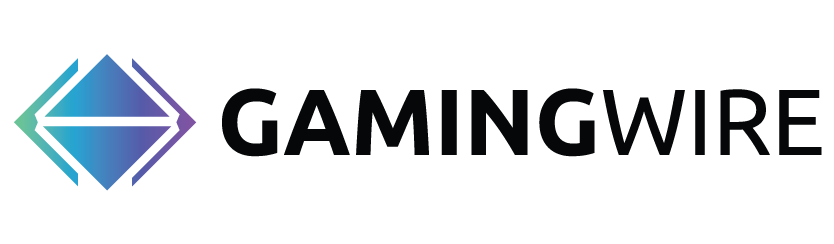

Every MediaFuse brand uses the **same External API endpoints, authentication, and response formats**. The only difference is the base URL.

<Warning>
  **Use the base URL of the brand your API key was issued on.** Each brand has its own accounts and orders, so a FinanceWire key only works on the FinanceWire address and returns `401` everywhere else. If you are not sure which brand your key belongs to, check the email you received it in or ask your account manager.
</Warning>

On every API reference page, the request examples have a tab for each brand, and the **Try it** playground lets you pick the brand's server from a dropdown.

## All base URLs

| Brand | Base URL |
|---|---|
| Chainwire | `https://app.chainwire.org/api/external-api/v1` |
| FinanceWire | `https://app.financewire.com/api/external-api/v1` |
| CyberNewsWire | `https://app.cybernewswire.com/api/external-api/v1` |
| GamingWire | `https://app.gamingwire.io/api/external-api/v1` |
| TechnologyWire | `https://app.technologywire.com/api/external-api/v1` |
| PlayNewswire | `https://app.playnewswire.com/api/external-api/v1` |
| NewsDirect | `https://clients.newsdirect.com/api/external-api/v1` |

---

## Chainwire


Crypto & blockchain PR distribution.

```bash
https://app.chainwire.org/api/external-api/v1
```

## FinanceWire


Finance & markets PR distribution.

```bash
https://app.financewire.com/api/external-api/v1
```

## CyberNewsWire


Cybersecurity PR distribution.

```bash
https://app.cybernewswire.com/api/external-api/v1
```

## GamingWire




Gaming industry PR distribution.

```bash
https://app.gamingwire.io/api/external-api/v1
```

## TechnologyWire


Technology industry PR distribution.

```bash
https://app.technologywire.com/api/external-api/v1
```

## PlayNewswire


iGaming & betting PR distribution.

```bash
https://app.playnewswire.com/api/external-api/v1
```

## NewsDirect


Multimedia press releases with targeted industry distribution.

<Note>
  NewsDirect's API lives on `clients.newsdirect.com`, not `app.newsdirect.com`.
</Note>

```bash
https://clients.newsdirect.com/api/external-api/v1
```
